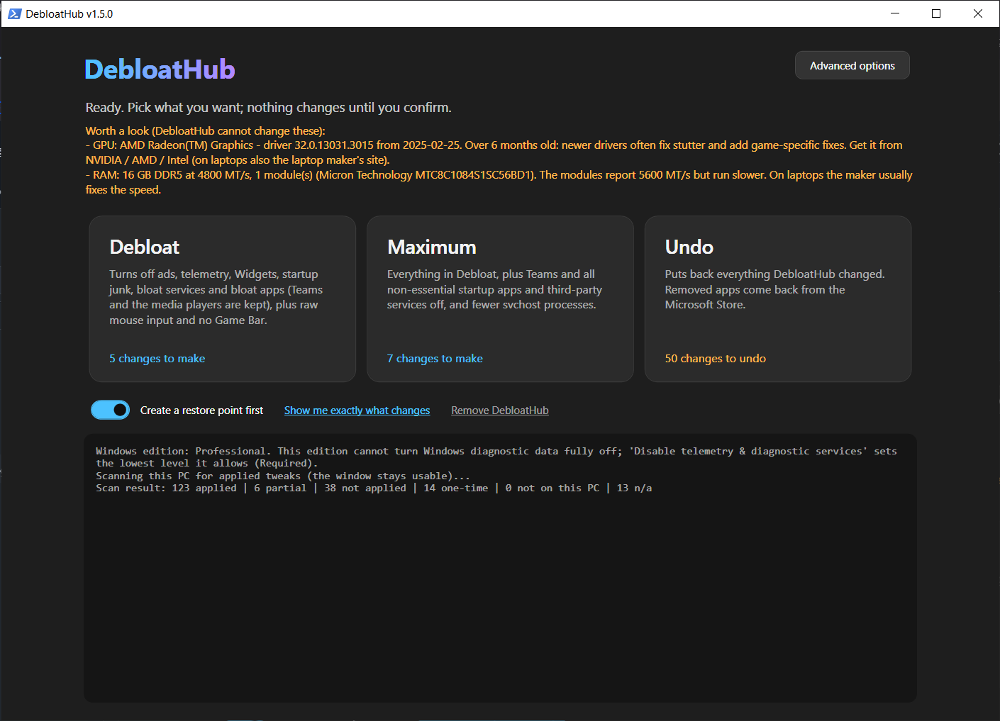
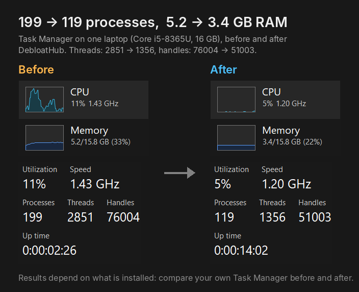

<h1 align="center">DebloatHub</h1>

<p align="center"><b>Windows 10/11 debloat, privacy and performance tweaks in one window.<br>See what every switch does, apply only what you want, undo it later.</b></p>

<p align="center">
  <a href="https://github.com/GrappurA/DebloatHub/releases/latest"></a>
  <a href="https://github.com/GrappurA/DebloatHub/actions/workflows/ci.yml"></a>
  
  <a href="LICENSE"></a>
</p>

<p align="center"></p>

## Install

Open PowerShell, paste this line and press Enter (click **Yes** when Windows asks for administrator rights):

```powershell
irm https://grappura.github.io/DebloatHub/install.ps1 | iex
```

It downloads the latest release, checks its SHA-256 checksum and starts DebloatHub. Run it again to update. Prefer to inspect everything first? **[Download DebloatHub.zip](https://github.com/GrappurA/DebloatHub/releases/latest/download/DebloatHub.zip)**, extract it and double-click `Start DebloatHub.bat`.

Requirements: Windows 10 or 11 (64-bit) and an administrator account. Nothing is installed.

## What it does

<p align="center"></p>

- **Simple view:** three buttons. *Debloat* turns off ads, telemetry, Widgets, Copilot, bloat apps, background services and startup junk, plus the gaming basics. *Maximum* goes further: fewer svchost processes, non-essential startup apps, third-party services and tasks off. *Undo* puts back everything DebloatHub changed.
- **Advanced view:** 130+ tweaks in 12 sections, each with a risk badge, pros and cons and the exact registry, service or task change. Your own startup apps, scheduled tasks and services are listed too.

<p align="center"></p>

## Why you can trust it

- **You see everything first.** Every switch shows what it changes; *Dry run* lists the exact actions without changing anything.
- **Real undo.** The original value, start type or task state is recorded before the first change and restored exactly. What cannot be undone (removed apps, cleanups) is marked *No undo*.
- **Verified.** After each change the system is read again; anything that did not stick is reported as failed.
- **Restore point first** (on by default). If Windows cannot create one, nothing is changed.
- **One readable script.** No compiled binaries, no telemetry, nothing downloaded while it runs. The installer checks the release checksum before starting anything.
- **Tested on real Windows.** Before each release is published, its tweaks are applied, verified and undone on clean Windows Server 2022 and 2025 machines in [GitHub Actions](https://github.com/GrappurA/DebloatHub/actions).

## Remove it

Click **Remove DebloatHub** (Advanced view, or the link at the bottom of the Simple view). It offers to undo its changes first, then deletes its files, logs and settings.

## More

- [Reference](docs/REFERENCE.md): every section and tweak, how apply and undo work, command line, files it uses, FAQ
- [Changelog](CHANGELOG.md) · [Contributing](CONTRIBUTING.md) · [Security](SECURITY.md)

**Credits.** DebloatHub re-implements ideas and settings from [winutil](https://github.com/ChrisTitusTech/winutil), [Win11Debloat](https://github.com/Raphire/Win11Debloat), [Sophia-Script-for-Windows](https://github.com/farag2/Sophia-Script-for-Windows), [Windows10Debloater](https://github.com/Sycnex/Windows10Debloater), [Debloat-Windows-10](https://github.com/W4RH4WK/Debloat-Windows-10), [privacy.sexy](https://github.com/undergroundwires/privacy.sexy), [RemoveWindowsAI](https://github.com/zoicware/RemoveWindowsAI), [winscript](https://github.com/flick9000/winscript), [Windows-Maintenance-Tool](https://github.com/ios12checker/Windows-Maintenance-Tool), [Winhance](https://github.com/memstechtips/Winhance), [g-helper](https://github.com/seerge/g-helper). Each tweak lists the tools that contain it.

**License:** [MIT](LICENSE). Provided as is, without warranty: keep the restore point on and read the cons of anything marked Moderate or Advanced.
