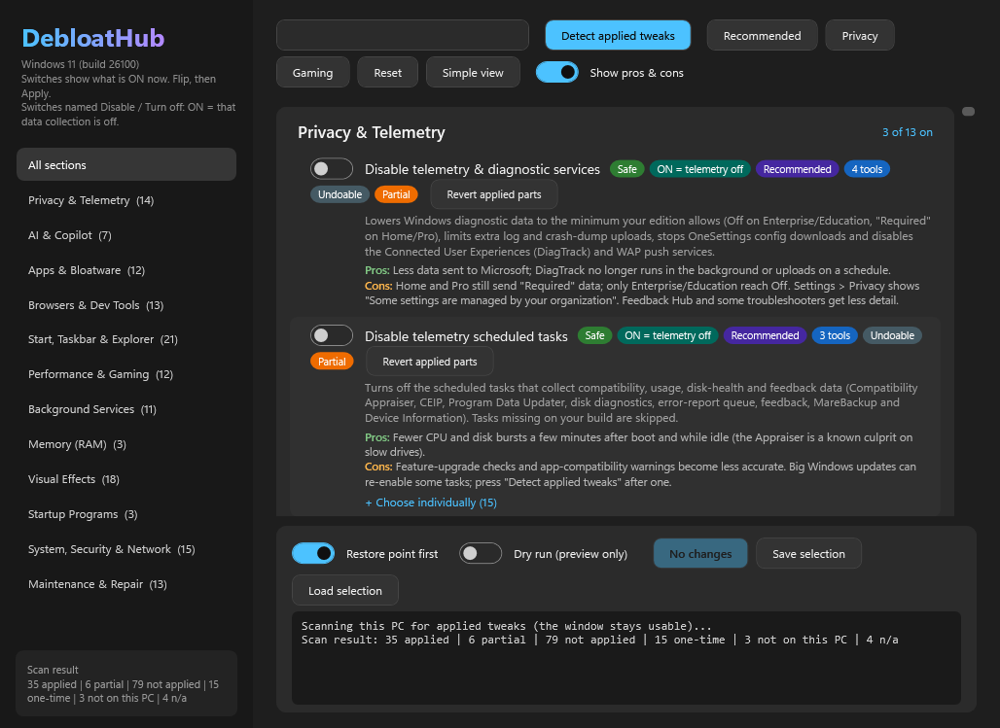

<h1 align="center">DebloatHub</h1>

<p align="center"><b>One GUI for 120+ Windows 10/11 debloat, privacy and performance tweaks.<br>Every change is previewable, verified and reversible.</b></p>

<p align="center">
  <a href="https://github.com/GrappurA/DebloatHub/releases/latest/download/DebloatHub.zip"></a>
</p>

<p align="center">or paste this into PowerShell (copy button on the right of the box):</p>

```powershell
irm https://grappura.github.io/DebloatHub/install.ps1 | iex
```

<p align="center">
  <a href="https://github.com/GrappurA/DebloatHub/releases/latest"></a>
  <a href="https://github.com/GrappurA/DebloatHub/releases"></a>
  
  
  
  <a href="https://github.com/GrappurA/DebloatHub/actions/workflows/ci.yml"></a>
  <a href="LICENSE"></a>
</p>

<p align="center"></p>

DebloatHub merges the most useful tweaks from popular debloat projects (WinUtil, Win11Debloat, Sophia Script, Windows10Debloater, privacy.sexy, RemoveWindowsAI and others) into one dark, sectioned WPF window. Instead of running a script and hoping for the best, you see **what every switch does, who needs it and its pros and cons**. You flip only what you want and press **Apply**. DebloatHub records what was there before, checks that each change really took effect, and can put it back later.

---

## Contents

- [Features](#features)
- [Quick start](#quick-start)
- [What it can change](#what-it-can-change)
- [How it works](#how-it-works)
- [Safety](#safety)
- [ASUS / G-Helper laptops](#asus--g-helper-laptops)
- [Command line (unattended)](#command-line-unattended)
- [Adding your own tweaks](#adding-your-own-tweaks)
- [Files and registry keys DebloatHub uses](#files-and-registry-keys-debloathub-uses)
- [FAQ](#faq)
- [Contributing and security](#contributing-and-security)
- [Credits](#credits)
- [License](#license)
- [Disclaimer](#disclaimer)

---

## Features

- **System check.** Flags the things no tweak can fix but that matter most: outdated GPU driver, a monitor stuck at 60 Hz, RAM at default speed (XMP/EXPO off) or in single channel, Memory Integrity status.
- **Simple or Advanced.** Simple is three buttons: *Debloat*, *Maximum* and *Undo*, each showing how many changes it makes. Advanced is the full list below with every switch, detail and preset. Switch any time.
- **130+ tweaks in 12 sections**, plus your own startup programs (Run keys, Startup folders and Microsoft Store app startup tasks), which are read from this PC.
- **Switches show the real state.** On start, DebloatHub scans the PC and every switch shows what is ON right now: *Applied*, *Partial*, *Not applied*, *Not on this PC* (the service, task or program it changes is not installed) or *Not available here* (other Windows version).
- **Nothing gets stuck after a Windows upgrade.** A Windows 10-only tweak you applied before upgrading to Windows 11 shows a purple *Left over* badge and can still be switched off and undone.
- **Choose item by item.** Groups (apps, services, scheduled tasks, Windows features, browser policies) open into one switch per item. You keep the Print Spooler and turn off Fax, or remove Solitaire but keep Calculator.
- **Pros and cons on screen.** Every tweak shows its pros and cons under the description. Hover the switch for the full card: what it does, do you need it, what it affects, a recommendation and the exact registry/service/task changes.
- **Real undo.** Before the first change, DebloatHub saves the *original* value, start type, task state or feature state. Switching it off later restores exactly that, not a guessed "default".
- **Verified apply.** After each change the real system is checked again. Anything that did not take effect is reported as failed, not as done.
- **Safety net.** Optional restore point before applying, a Dry run mode that only previews, and a confirmation that lists one-time actions and risky items.
- **Progress and time left.** While changes are applied, a progress bar shows the step, the percentage done and an estimate of the time left (in both views).
- **Recommended preset.** A curated list marked with a *Recommended* badge: performance and privacy tweaks, hidden taskbar search, bloat apps removed (only Teams and the default Media Player and Movies & TV players are kept), bloat services set to start on demand (Xbox, Phone Link, Fax, Remote Registry, IP Helper, diagnostics), every non-essential startup app off (classic and Microsoft Store apps), and the gaming basics: Game Mode, windowed-game optimizations, raw mouse input, no Game Bar, Game DVR or Sticky Keys pop-ups. Drivers, audio, touchpad, GPU, printers, security, sync, VPN, remote access, databases and G-Helper stay on. Everything except the removed apps can be undone with one click.
- **Maximum preset.** Everything in Recommended, plus the bigger RAM and process savings, marked with a *Maximum* badge: services grouped into fewer svchost processes, Teams and every other non-essential startup app off (Teams stays installed and opens normally), non-essential third-party auto-start services set to Manual, third-party scheduled tasks that are not updaters or backups off, Error Reporting, the AI Fabric service and (Windows 10) the Ndu driver off, hardware-accelerated GPU scheduling on, no automatic restarts while you are signed in, no OneDrive ads in Explorer, no Task View, People or Meet Now buttons, Chrome no longer running after you close it, no VS Code npm lookups and no handwriting or typing samples collected. Deliberately left alone so nothing essential breaks: Night light (Connected Devices Platform), Snipping Tool, printing and Print to PDF, Bluetooth, Windows Hello, Windows Search, Remote Desktop, background-app notifications, Memory Integrity and thumbnails. All of it can be undone with one click.
- **Other presets.** *Privacy* and *Gaming* also only move switches; nothing happens until you press Apply. They never pre-select **Advanced** items (such as turning off Memory Integrity) or anything that cannot be undone (app removals); the log lists those so you can decide yourself. On laptops, *Gaming* also skips the Ultimate Performance plan. *Reset* returns every switch to the current system state.
- **Visual Effects presets.** *Maximize looks*, *Recommended* and *Maximize performance* set the switches; after Apply, the effects change instantly, without a sign-out.
- **Save and load your selection** as a JSON file (you choose where) to reuse on other PCs, also unattended from the command line.
- **Log file.** Everything in the log window is also written to `%ProgramData%\DebloatHub\Logs` (kept 90 days), so you can check later what was changed.
- **Version aware.** Windows 10-only and Windows 11-only tweaks are shown as "Not available here" on the other version.
- **Runs in the background.** Scans and applies run off the UI thread, with a live log, so the window stays responsive.
- **Correct user even after UAC.** If UAC elevates to a different admin account, per-user settings still go to the signed-in user's profile.
- **No install, no downloads.** One PowerShell script and a launcher. Nothing is fetched from the internet.
- **Always 64-bit, one copy at a time.** Started from a 32-bit program, it relaunches itself in 64-bit PowerShell (otherwise machine-wide policies would land in the wrong registry view). A second copy refuses to start while one is open.

## Quick start

**Option 1: one line in PowerShell (quickest).** Open PowerShell (Start menu, type *PowerShell*, Enter), paste this and press Enter:

```powershell
irm https://grappura.github.io/DebloatHub/install.ps1 | iex
```

It downloads `DebloatHub.ps1` from the latest release, checks its SHA-256 against the release's `SHA256SUMS.txt`, keeps it in `%LOCALAPPDATA%\DebloatHub` and starts it; click **Yes** for administrator rights. Run the same line again to update. [`install.ps1`](install.ps1) is short, so read it first if you like. If `grappura.github.io` is blocked on your network, the same installer is attached to every release:

```powershell
irm https://github.com/GrappurA/DebloatHub/releases/latest/download/install.ps1 | iex
```

**Option 2: the zip (inspect everything first).**

1. **[Download DebloatHub.zip](https://github.com/GrappurA/DebloatHub/releases/latest/download/DebloatHub.zip)** and extract it anywhere (the zip contains a short `README.txt` with these steps). Extract it first: do not run it from inside the zip.
2. Double-click **`Start DebloatHub.bat`** and accept the administrator prompt.

> **"Windows protected your PC"?** Windows shows this for any downloaded script that is not code-signed. Click **More info › Run anyway**. Or before extracting, right-click the zip › **Properties** › tick **Unblock** › OK.

**Check your download (optional).** Every release lists the SHA-256 of its files in `SHA256SUMS.txt`. In PowerShell, in your Downloads folder, run `Get-FileHash DebloatHub.zip` and compare the hash with that file. (The one-liner does this check for you.)

**Then:** wait for the first scan, flip switches or start from a preset, leave **Restore point first** on (optionally try **Dry run**) and press **Apply**. Sign out or reboot when the log says so.

Both options run the same program from the same release, and your undo records are kept when you switch between them or update. The download page is also at **https://grappura.github.io/DebloatHub/**.

**Requirements:** Windows 10 or 11 (64-bit), Windows PowerShell 5.1 (built in), administrator rights.

> Tip: try it in a virtual machine first, and read the cards of anything marked **Moderate** or **Advanced**.

To troubleshoot, run `DebloatHub.ps1 -ShowConsole` to keep the console visible. Startup errors are written to `%TEMP%\DebloatHub-error.log`, and the full log of every session to `%ProgramData%\DebloatHub\Logs`.

All versions and their changes are listed on the [Releases page](https://github.com/GrappurA/DebloatHub/releases) and in [CHANGELOG.md](CHANGELOG.md).

## What it can change

| Section | What is inside |
|---|---|
| **Privacy & Telemetry** | Diagnostic data level, telemetry services and scheduled tasks, app-compatibility inventory, advertising ID, activity history, tailored experiences, web results in Start, location, error reporting, CEIP, feedback prompts, NVIDIA and Office telemetry, camera/mic defaults |
| **AI & Copilot** | Recall (policy and optional feature), Copilot, Copilot taskbar button, Click to Do, AI Fabric service, Copilot apps |
| **Apps & Bloatware** | Microsoft consumer apps, Teams/Cortana, optional extras, Xbox apps, third-party promo apps and games, 3D/Mixed Reality, legacy apps, Windows 11 extras (incl. the Widgets package), OneDrive (uninstall plus an optional policy that keeps it from coming back), OEM vendor apps (one switch per package) |
| **Browsers & Dev Tools** | Shown only for programs you have installed. Edge (startup boost, background mode, sidebar, shopping, Rewards/MSN feed, sleeping tabs, telemetry, hardening), Chrome, Firefox (telemetry, sponsored content, background updates), VS Code `settings.json` (edited in place, comments kept), Visual Studio, telemetry opt-outs for 14 developer CLIs |
| **Start, Taskbar & Explorer** | Start/lock-screen ads and silent installs, Windows 11 Start recommendations and account notifications, OneDrive ads in Explorer, classic right-click menu, Widgets, News and Interests, taskbar alignment and buttons, search box, search highlights, End Task, file extensions, hidden files, Explorer defaults |
| **Performance & Gaming** | System check (GPU driver, refresh rate, RAM speed and channels), Game Mode, windowed-game optimizations, GPU scheduling, Memory Integrity, Fast Startup, hibernation, Ultimate Performance plan (undo returns to your previous plan), Game DVR, Game Bar, mouse acceleration, background apps, Xbox cloud-save task, NVIDIA services while the dGPU is off (G-Helper Eco) |
| **Background Services** | **Manual mode** (default): services no longer start at boot, but Windows still starts them when something asks, so nothing breaks. **Strict mode**: Disabled, never starts. Per-service switches grouped by feature, including third-party updaters (Google, Brave, Adobe, Dropbox, HP, Dell, AMD): printing & scanning, Xbox, Phone Link, Windows Hello biometrics, Bluetooth, network sharing, Remote Desktop, IP Helper, diagnostics, ASUS services, SysMain, Search indexing, start-on-demand services, and fewer `svchost.exe` processes |
| **Memory (RAM)** | Ndu driver (non-paged pool leak), memory compression, empty standby memory |
| **Visual Effects** | All 17 *Performance Options* effects as separate switches, plus transparency, with three presets |
| **Autoruns** | Everything that starts automatically: every startup app (Run keys, Startup folders and Microsoft Store app startup tasks such as new Teams or Spotify, same mechanism as Task Manager), third-party scheduled tasks and third-party auto-start services. Disable only, never delete, always undoable. |
| **System, Security & Network** | Delivery Optimization, Storage Sense, update restarts, driver updates through Windows Update, BitLocker auto-encryption, Cloudflare DNS (only the adapters that carry your internet connection, never VPNs; each adapter's own DNS is restored on undo), AutoPlay, LLMNR, Remote Assistance, Windows Script Host, clipboard history, online speech, legacy Windows features (SMB 1.0, PowerShell 2.0...) |
| **Maintenance & Repair** | One-time actions: SFC, DISM, component cleanup, old driver packages, temp/browser/thumbnail/crash-dump/Delivery Optimization cleanup, Windows Update reset, network reset, DNS flush, SSD TRIM |

Every tweak carries a risk badge:

- **Safe**: good for almost everyone.
- **Moderate**: read the pros and cons first.
- **Advanced**: can break features; experts only.

Badges also show which source tools contain the tweak and whether it can be undone.

## How it works

**A switch ON means the tweak is applied.** For "Disable …" switches, ON means that feature or that data collection is off.

1. **Scan.** On start, and whenever you press *Detect applied tweaks*, DebloatHub reads the real state: registry values, service start types, scheduled tasks, installed apps, optional features, visual-effect settings, JSON settings and power plans.
2. **Pending changes.** Every switch you flip away from the scanned state is marked with a blue bar. The Apply button shows the count.
3. **Apply.** For every change DebloatHub:
   - skips it if it is already in the requested state, so apply is idempotent;
   - records the original state, but only the first time, so a later apply never overwrites the real original;
   - makes the change;
   - re-reads the system and reports it as failed if it did not stick.
4. **Revert.** Switching a tweak off and pressing Apply restores the recorded original. If there is no record (for example the setting was changed by another tool before DebloatHub ever saw it), it falls back to Windows' documented default and warns you first.

Tweaks are defined as data, not code. Each one is a list of *actions*:

| Action | What it does | Undo |
|---|---|---|
| `Reg` | Set or delete a registry value (HKCU values follow the signed-in user) | Original value, type, or "did not exist" |
| `Svc` / `SvcM` | Set a service to Disabled / Manual | Original start type (including delayed start); restarts it if it was running |
| `Task` | Disable a scheduled task | Re-enable if it was enabled |
| `App` | Remove an AppX package for all users, including the provisioned copy | Not automatic; reinstall from the Store |
| `Feat` | Disable an optional Windows feature | Re-enable if it was enabled |
| `Startup` | Disable a startup entry via `StartupApproved` (same as Task Manager) | Original entry bytes |
| `Spi` | Change a visual effect live (`SystemParametersInfo`) | Original value |
| `Json` | Change one key in a JSON/JSONC file in place (comments, order and trailing commas kept; `.debloathub.bak` backup) | Original value or key removed |
| `Cmd` | Run a command (one-time actions, or with an undo command and a detector) | Undo command, if defined (DNS and power plan record and restore what was there before) |

## Safety

- **Restore point** before applying (on by default). DebloatHub temporarily lifts Windows' one-per-24-hours limit so the point is really created. **If the restore point cannot be created, nothing is changed** and you are told why; turn the option off to continue without one. If System Protection was off for the Windows drive, DebloatHub turns it on (a restore point needs it) and says so in the log.
- **Dry run** logs every action without changing anything.
- **Confirmation dialog** lists one-time actions that cannot be undone, items with special warnings, and reverts that have no recorded original.
- **Fail-closed actions.** For example, the Driver Store cleanup deletes nothing if it cannot read which drivers are in use. It never touches boot-critical, printer or in-use drivers, and it lets Windows refuse packages that an unplugged device still uses (no `/force`).
- **Link-safe cleanups.** Temp, browser-cache, crash-dump and update-cache cleanups never follow junctions or symbolic links, so a link inside a user folder can never make the elevated cleanup delete files somewhere else.
- **No hidden downloads or third-party binaries.** Standby-memory flushing uses the Windows API directly instead of RAMMap.
- Things that **cannot be undone automatically** are labelled *No undo*. After applying they show as *Applied – cannot be undone* and are locked: removed apps, cleanups, repairs.

## ASUS / G-Helper laptops

- **Stop NVIDIA services while the dGPU is off (G-Helper Eco).** Adds a scheduled task that runs 30 seconds after startup and sign-in. If the NVIDIA GPU is powered off, it stops *NVIDIA Display Container* and *NVIDIA Container*.
  - It complements G-Helper's *Extra › Stop/Start NVIDIA services based on dGPU state*. That option only reacts when you switch modes, while this task covers booting straight into Eco.
  - Keep the G-Helper option on, so the services come back when you switch to Standard.
  - It only appears on PCs with NVIDIA drivers.
- **ASUS services (replaced by G-Helper).** The same service list and settings as G-Helper's *Extra › Stop* button, but with one switch per service and full undo. The touchpad service is never touched.

## Command line (unattended)

The same engine runs without a window, for example to set up several PCs the same way. Run from an **elevated** PowerShell window (so the exit code reaches your script):

```powershell
.\DebloatHub.ps1 -Preset Debloat                 # same as the Simple view's Debloat button
.\DebloatHub.ps1 -Preset Maximum                 # same as the Simple view's Maximum button
.\DebloatHub.ps1 -Preset Undo                    # put back everything DebloatHub changed
.\DebloatHub.ps1 -Uninstall                      # remove DebloatHub itself (its changes stay)
.\DebloatHub.ps1 -Selection .\my-selection.json  # a file saved with "Save selection"
```

| Option | Meaning |
|---|---|
| `-DryRun` | Only list what would change |
| `-NoRestorePoint` | Skip the restore point |

With `-Selection`, switches in the file are applied and **every other switch is reverted**, exactly like *Load selection* + *Apply* in the window. Exit codes: `0` OK, `1` some items failed, `2` error, `3` another copy is running, `4` no restore point could be created (nothing was changed). The log is printed and also saved to `%ProgramData%\DebloatHub\Logs`.

## Adding your own tweaks

Tweaks are declared in the database near the top of `DebloatHub.ps1`:

```powershell
fTw $s5 'Show file extensions' 'Explorer shows the full file name including the extension.' Safe 'WinUtil, Sophia' Any 'safe' `
    @(fReg 'HKCU:\Software\Microsoft\Windows\CurrentVersion\Explorer\Advanced' HideFileExt 0 1)
$more['Show file extensions']=@('Who needs it', 'Pros', 'Cons')
```

`fTw <section> <name> <description> <Safe|Moderate|Advanced> <sources> <Any|10|11> <presets: safe,privacy,gaming,telemetry> <actions> [recommendation]`

Action constructors:

| Constructor | Arguments |
|---|---|
| `fReg` | path, name, value, fallback-undo value (`$null` = delete), [type], [only-if-key-exists] |
| `fSvc` / `fSvm` | service name, fallback start type for undo |
| `fApp` | AppX name, wildcards allowed |
| `fTask` | `\Path\TaskName` |
| `fFeat` | feature name |
| `fJson` | file, key, value, fallback undo |
| `fCmd` | command, [undo command], [detector expression that returns `$true` when applied], [label] |

A tweak made only of apps, tasks, services, features or JSON keys automatically gets one switch per item.

Run the tests before opening a pull request: `powershell -File tests\Test-DebloatHub.ps1`. They check the syntax, that every Recommended entry and every engine function exists, the JSONC editor, the Driver Store selection and the link-safe cleanup. CI runs them on every push, together with unattended dry runs of every preset on a real Windows machine.

## Files and registry keys DebloatHub uses

| Location | Purpose |
|---|---|
| `HKLM\SOFTWARE\DebloatHub\Snapshots` | Original states recorded before the first change (used by undo) |
| `HKLM\SOFTWARE\DebloatHub\Applied` | Markers for reversible commands without their own detector |
| `HKLM\SOFTWARE\DebloatHub\Dns` | Each network adapter's DNS servers before *Use Cloudflare DNS* |
| `HKLM\SOFTWARE\DebloatHub\Power` | The power plan that was active before *Ultimate Performance* |
| `%LOCALAPPDATA%\DebloatHub` | The script, when installed with the one-liner |
| `HKCU\SOFTWARE\DebloatHub` | UI preferences (pros & cons, Simple/Advanced, service mode) |
| `%ProgramData%\DebloatHub\Logs` | Log of every session (kept 90 days) |
| Task Scheduler › `DebloatHub` | Tasks created by tweaks (only when you enable them) |
| `<file>.debloathub.bak` | First-time backup of any JSON settings file it edits |
| `DebloatHub-selection.json` | Your saved selection (Desktop by default; you choose the place) |
| `%TEMP%\DebloatHub-error.log` | Startup error details |

**To remove DebloatHub,** click **Remove DebloatHub** (Advanced view, next to *Load selection*, or the link at the bottom of the Simple view). If DebloatHub's changes are still applied, it asks first: *Yes* undoes them and then removes DebloatHub, *No* keeps them and removes only DebloatHub. It deletes everything in this table except your saved selection files and `.debloathub.bak` backups, and it deletes the folder it was started from only when that folder holds nothing but the zip's files. Without a window: `.\DebloatHub.ps1 -Uninstall` (keeps the changes; run `-Preset Undo` first to revert them).

## FAQ

**Will Windows Update undo my changes?**
Sometimes. Big feature updates can re-enable scheduled tasks or reinstall apps. Press *Detect applied tweaks* afterwards; anything that came back shows as *Not applied* or *Partial*. Use *Complete this tweak now* (right-click a row) to re-apply.

**Edge, Chrome or Office say "Managed by your organization".**
That is expected: those tweaks use the official policy settings. Turn the tweak off to remove the policy.

**Does it make Windows faster?**
Some tweaks reduce background work: fewer services, startup apps and telemetry scans, and no Widgets or Edge preloading. Many are about privacy, ads and clutter. The cards say honestly when a tweak is mostly cosmetic, for example fewer svchost processes or disabling SysMain on an SSD.

**Can I use it together with other debloat tools?**
Yes. Settings changed by other tools are detected as applied. Undo then uses Windows' documented defaults, because DebloatHub never saw the original value, and it tells you so before reverting.

## Contributing and security

Bug reports and new tweaks are welcome: see [CONTRIBUTING.md](CONTRIBUTING.md). Please report security problems privately as described in [SECURITY.md](SECURITY.md), not in a public issue.

## Credits

DebloatHub collects and re-implements ideas and settings from these projects. Each tweak's badge lists the tools that contain it.

- [ChrisTitusTech/winutil](https://github.com/ChrisTitusTech/winutil)
- [Raphire/Win11Debloat](https://github.com/Raphire/Win11Debloat)
- [farag2/Sophia-Script-for-Windows](https://github.com/farag2/Sophia-Script-for-Windows)
- [Sycnex/Windows10Debloater](https://github.com/Sycnex/Windows10Debloater)
- [W4RH4WK/Debloat-Windows-10](https://github.com/W4RH4WK/Debloat-Windows-10)
- [undergroundwires/privacy.sexy](https://github.com/undergroundwires/privacy.sexy)
- [zoicware/RemoveWindowsAI](https://github.com/zoicware/RemoveWindowsAI)
- [flick9000/winscript](https://github.com/flick9000/winscript)
- [ios12checker/Windows-Maintenance-Tool](https://github.com/ios12checker/Windows-Maintenance-Tool)
- [memstechtips/Winhance](https://github.com/memstechtips/Winhance) (feature and UI reference)
- [seerge/g-helper](https://github.com/seerge/g-helper) (ASUS service list and Eco-mode behaviour)

## License

[MIT](LICENSE). The credited projects are the source of the *ideas and settings*; DebloatHub's code is its own.

## Disclaimer

DebloatHub changes system settings, services and installed apps. It is provided **as is, without warranty**. Read the description and cons of every tweak, keep the restore point option on, and test on a non-critical PC or VM first. You are responsible for the changes you apply.
