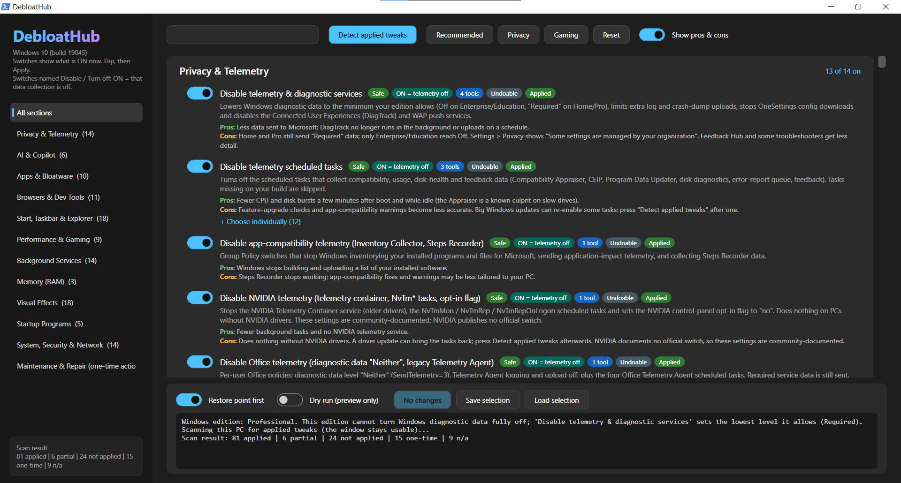

<h1 align="center">DebloatHub</h1>

<p align="center"><b>One GUI for 120+ Windows 10/11 debloat, privacy and performance tweaks.<br>Every change is previewable, verified and reversible.</b></p>

<p align="center">
  <a href="https://github.com/GrappurA/DebloatHub/releases/latest/download/DebloatHub.zip"></a>
</p>

<p align="center">
  <a href="https://github.com/GrappurA/DebloatHub/releases/latest"></a>
  <a href="https://github.com/GrappurA/DebloatHub/releases"></a>
  
  
  
</p>

<p align="center"></p>

DebloatHub merges the most useful tweaks from popular debloat projects (WinUtil, Win11Debloat, Sophia Script, Windows10Debloater, privacy.sexy, RemoveWindowsAI and others) into one dark, sectioned WPF window. Instead of running a script and hoping for the best, you see **what every switch does, who needs it and its pros and cons**. You flip only what you want and press **Apply**. DebloatHub records what was there before, checks that each change really took effect, and can put it back later.

---

## Contents

- [Features](#features)
- [Quick start](#quick-start)
- [What it can change](#what-it-can-change)
- [How it works](#how-it-works)
- [Safety](#safety)
- [ASUS / G-Helper laptops](#asus--g-helper-laptops)
- [Adding your own tweaks](#adding-your-own-tweaks)
- [Files and registry keys DebloatHub uses](#files-and-registry-keys-debloathub-uses)
- [FAQ](#faq)
- [Credits](#credits)
- [Disclaimer](#disclaimer)

---

## Features

- **120+ tweaks in 11 sections**, plus your own startup programs, which are read from this PC.
- **Switches show the real state.** On start, DebloatHub scans the PC and every switch shows what is ON right now: *Applied*, *Partial*, *Not applied* or *Not available here*.
- **Choose item by item.** Groups (apps, services, scheduled tasks, Windows features, browser policies) open into one switch per item. You keep the Print Spooler and turn off Fax, or remove Solitaire but keep Calculator.
- **Pros and cons on screen.** Every tweak shows its pros and cons under the description. Hover the switch for the full card: what it does, do you need it, what it affects, a recommendation and the exact registry/service/task changes.
- **Real undo.** Before the first change, DebloatHub saves the *original* value, start type, task state or feature state. Switching it off later restores exactly that, not a guessed "default".
- **Verified apply.** After each change the real system is checked again. Anything that did not take effect is reported as failed, not as done.
- **Safety net.** Optional restore point before applying, a Dry run mode that only previews, and a confirmation that lists one-time actions and risky items.
- **Presets.** *Recommended*, *Privacy* and *Gaming* only move switches; nothing happens until you press Apply. *Reset* returns every switch to the current system state.
- **Visual Effects presets.** *Maximize looks*, *Recommended* and *Maximize performance* set the switches; after Apply, the effects change instantly, without a sign-out.
- **Save and load your selection** as a JSON file to reuse on other PCs.
- **Version aware.** Windows 10-only and Windows 11-only tweaks are shown as "Not available here" on the other version.
- **Runs in the background.** Scans and applies run off the UI thread, with a live log, so the window stays responsive.
- **Correct user even after UAC.** If UAC elevates to a different admin account, per-user settings still go to the signed-in user's profile.
- **No install, no downloads.** One PowerShell script and a launcher. Nothing is fetched from the internet.

## Quick start

1. **[Download DebloatHub.zip](https://github.com/GrappurA/DebloatHub/releases/latest/download/DebloatHub.zip)** and extract it anywhere. Extract it first: do not run it from inside the zip.
2. Double-click **`Start DebloatHub.bat`** and accept the administrator prompt.
3. Wait for the first scan, then flip switches or start from a preset.
4. Leave **Restore point first** on, optionally try **Dry run**, and press **Apply**.
5. Sign out or reboot when the log says so.

> **"Windows protected your PC"?** Windows shows this for any downloaded script that is not code-signed. Click **More info › Run anyway**. Or before extracting, right-click the zip › **Properties** › tick **Unblock** › OK.

**Prefer PowerShell?** Paste this into a PowerShell window. It downloads the script to your Temp folder and starts it, asking for admin rights itself:

```powershell
[Net.ServicePointManager]::SecurityProtocol="Tls12"; $p="$env:TEMP\DebloatHub.ps1"; irm https://github.com/GrappurA/DebloatHub/releases/latest/download/DebloatHub.ps1 -OutFile $p; powershell -NoProfile -ExecutionPolicy Bypass -File $p
```

**Requirements:** Windows 10 or 11 (64-bit), Windows PowerShell 5.1 (built in), administrator rights.

> Tip: try it in a virtual machine first, and read the cards of anything marked **Moderate** or **Advanced**.

To troubleshoot, run `DebloatHub.ps1 -ShowConsole` to keep the console visible. Startup errors are written to `%TEMP%\DebloatHub-error.log`.

All versions and their changes are listed on the [Releases page](https://github.com/GrappurA/DebloatHub/releases) and in [CHANGELOG.md](CHANGELOG.md).

## What it can change

| Section | What is inside |
|---|---|
| **Privacy & Telemetry** | Diagnostic data level, telemetry services and scheduled tasks, app-compatibility inventory, advertising ID, activity history, tailored experiences, web results in Start, location, error reporting, CEIP, feedback prompts, NVIDIA and Office telemetry, camera/mic defaults |
| **AI & Copilot** | Recall (policy and optional feature), Copilot, Click to Do, AI Fabric service, Copilot apps |
| **Apps & Bloatware** | Microsoft consumer apps, Teams/Cortana, optional extras, Xbox apps, third-party promo apps and games, 3D/Mixed Reality, legacy apps, OneDrive, OEM vendor apps (one switch per package) |
| **Browsers & Dev Tools** | Edge (startup boost, background mode, sidebar, shopping, telemetry, hardening), Chrome, Firefox, VS Code `settings.json` (edited in place, comments kept), Visual Studio, telemetry opt-outs for 14 developer CLIs |
| **Start, Taskbar & Explorer** | Start/lock-screen ads and silent installs, Widgets, News and Interests, taskbar alignment and buttons, search box, search highlights, End Task, file extensions, hidden files, Explorer defaults |
| **Performance & Gaming** | Fast Startup, hibernation, Ultimate Performance plan, Game DVR, Game Bar, mouse acceleration, background apps, Xbox cloud-save task, NVIDIA services while the dGPU is off (G-Helper Eco) |
| **Background Services** | Per-service switches grouped by feature: printing & scanning, Xbox, Phone Link, Windows Hello biometrics, Bluetooth, network sharing, Remote Desktop, IP Helper, diagnostics, ASUS services, SysMain, Search indexing, start-on-demand services, and fewer `svchost.exe` processes |
| **Memory (RAM)** | Ndu driver (non-paged pool leak), memory compression, empty standby memory |
| **Visual Effects** | All 17 *Performance Options* effects as separate switches, plus transparency, with three presets |
| **Startup Programs** | Every Run-key and Startup-folder entry on this PC, disabled the same way as Task Manager > Startup apps |
| **System, Security & Network** | Delivery Optimization, Storage Sense, update restarts, BitLocker auto-encryption, Cloudflare DNS, AutoPlay, LLMNR, Remote Assistance, Windows Script Host, clipboard history, online speech, legacy Windows features (SMB 1.0, PowerShell 2.0...) |
| **Maintenance & Repair** | One-time actions: SFC, DISM, component cleanup, old driver packages, temp/browser/thumbnail/crash-dump/Delivery Optimization cleanup, Windows Update reset, network reset, DNS flush, SSD TRIM |

Every tweak carries a risk badge:

- **Safe**: good for almost everyone.
- **Moderate**: read the pros and cons first.
- **Advanced**: can break features; experts only.

Badges also show which source tools contain the tweak and whether it can be undone.

## How it works

**A switch ON means the tweak is applied.** For "Disable …" switches, ON means that feature or that data collection is off.

1. **Scan.** On start, and whenever you press *Detect applied tweaks*, DebloatHub reads the real state: registry values, service start types, scheduled tasks, installed apps, optional features, visual-effect settings, JSON settings and power plans.
2. **Pending changes.** Every switch you flip away from the scanned state is marked with a blue bar. The Apply button shows the count.
3. **Apply.** For every change DebloatHub:
   - skips it if it is already in the requested state, so apply is idempotent;
   - records the original state, but only the first time, so a later apply never overwrites the real original;
   - makes the change;
   - re-reads the system and reports it as failed if it did not stick.
4. **Revert.** Switching a tweak off and pressing Apply restores the recorded original. If there is no record (for example the setting was changed by another tool before DebloatHub ever saw it), it falls back to Windows' documented default and warns you first.

Tweaks are defined as data, not code. Each one is a list of *actions*:

| Action | What it does | Undo |
|---|---|---|
| `Reg` | Set or delete a registry value (HKCU values follow the signed-in user) | Original value, type, or "did not exist" |
| `Svc` / `SvcM` | Set a service to Disabled / Manual | Original start type (including delayed start); restarts it if it was running |
| `Task` | Disable a scheduled task | Re-enable if it was enabled |
| `App` | Remove an AppX package for all users, including the provisioned copy | Not automatic; reinstall from the Store |
| `Feat` | Disable an optional Windows feature | Re-enable if it was enabled |
| `Startup` | Disable a startup entry via `StartupApproved` (same as Task Manager) | Original entry bytes |
| `Spi` | Change a visual effect live (`SystemParametersInfo`) | Original value |
| `Json` | Change one key in a JSON/JSONC file in place (comments, order and trailing commas kept; `.debloathub.bak` backup) | Original value or key removed |
| `Cmd` | Run a command (one-time actions, or with an undo command and a detector) | Undo command, if defined |

## Safety

- **Restore point** before applying (on by default). DebloatHub temporarily lifts Windows' one-per-24-hours limit so the point is really created.
- **Dry run** logs every action without changing anything.
- **Confirmation dialog** lists one-time actions that cannot be undone, items with special warnings, and reverts that have no recorded original.
- **Fail-closed actions.** For example, the Driver Store cleanup deletes nothing if it cannot read which drivers are in use. It never touches boot-critical, printer or in-use drivers.
- **No hidden downloads or third-party binaries.** Standby-memory flushing uses the Windows API directly instead of RAMMap.
- Things that **cannot be undone automatically** are labelled *No undo*. After applying they show as *Applied – cannot be undone* and are locked: removed apps, cleanups, repairs.

## ASUS / G-Helper laptops

- **Stop NVIDIA services while the dGPU is off (G-Helper Eco).** Adds a scheduled task that runs 30 seconds after startup and sign-in. If the NVIDIA GPU is powered off, it stops *NVIDIA Display Container* and *NVIDIA Container*.
  - It complements G-Helper's *Extra › Stop/Start NVIDIA services based on dGPU state*. That option only reacts when you switch modes, while this task covers booting straight into Eco.
  - Keep the G-Helper option on, so the services come back when you switch to Standard.
  - It only appears on PCs with NVIDIA drivers.
- **ASUS services (replaced by G-Helper).** The same service list and settings as G-Helper's *Extra › Stop* button, but with one switch per service and full undo. The touchpad service is never touched.

## Adding your own tweaks

Tweaks are declared in the database near the top of `DebloatHub.ps1`:

```powershell
fTw $s5 'Show file extensions' 'Explorer shows the full file name including the extension.' Safe 'WinUtil, Sophia' Any 'safe' `
    @(fReg 'HKCU:\Software\Microsoft\Windows\CurrentVersion\Explorer\Advanced' HideFileExt 0 1)
$more['Show file extensions']=@('Who needs it', 'Pros', 'Cons')
```

`fTw <section> <name> <description> <Safe|Moderate|Advanced> <sources> <Any|10|11> <presets: safe,privacy,gaming,telemetry> <actions> [recommendation]`

Action constructors:

| Constructor | Arguments |
|---|---|
| `fReg` | path, name, value, fallback-undo value (`$null` = delete), [type], [only-if-key-exists] |
| `fSvc` / `fSvm` | service name, fallback start type for undo |
| `fApp` | AppX name, wildcards allowed |
| `fTask` | `\Path\TaskName` |
| `fFeat` | feature name |
| `fJson` | file, key, value, fallback undo |
| `fCmd` | command, [undo command], [detector expression that returns `$true` when applied] |

A tweak made only of apps, tasks, services, features or JSON keys automatically gets one switch per item.

## Files and registry keys DebloatHub uses

| Location | Purpose |
|---|---|
| `HKLM\SOFTWARE\DebloatHub\Snapshots` | Original states recorded before the first change (used by undo) |
| `HKLM\SOFTWARE\DebloatHub\Applied` | Markers for reversible commands without their own detector |
| `HKCU\SOFTWARE\DebloatHub` | UI preferences (e.g. show pros & cons) |
| Task Scheduler › `DebloatHub` | Tasks created by tweaks (only when you enable them) |
| `<file>.debloathub.bak` | First-time backup of any JSON settings file it edits |
| `Desktop\DebloatHub-selection.json` | Your saved selection |
| `%TEMP%\DebloatHub-error.log` | Startup error details |

To remove DebloatHub completely:

1. Switch off everything you want restored and press Apply.
2. Delete the script.
3. Optionally delete `HKLM\SOFTWARE\DebloatHub`. After that, undo can only use Windows' defaults.

## FAQ

**Will Windows Update undo my changes?**
Sometimes. Big feature updates can re-enable scheduled tasks or reinstall apps. Press *Detect applied tweaks* afterwards; anything that came back shows as *Not applied* or *Partial*. Use *Complete this tweak now* (right-click a row) to re-apply.

**Edge, Chrome or Office say "Managed by your organization".**
That is expected: those tweaks use the official policy settings. Turn the tweak off to remove the policy.

**Does it make Windows faster?**
Some tweaks reduce background work: fewer services, startup apps and telemetry scans, and no Widgets or Edge preloading. Many are about privacy, ads and clutter. The cards say honestly when a tweak is mostly cosmetic, for example fewer svchost processes or disabling SysMain on an SSD.

**Can I use it together with other debloat tools?**
Yes. Settings changed by other tools are detected as applied. Undo then uses Windows' documented defaults, because DebloatHub never saw the original value, and it tells you so before reverting.

## Credits

DebloatHub collects and re-implements ideas and settings from these projects. Each tweak's badge lists the tools that contain it.

- [ChrisTitusTech/winutil](https://github.com/ChrisTitusTech/winutil)
- [Raphire/Win11Debloat](https://github.com/Raphire/Win11Debloat)
- [farag2/Sophia-Script-for-Windows](https://github.com/farag2/Sophia-Script-for-Windows)
- [Sycnex/Windows10Debloater](https://github.com/Sycnex/Windows10Debloater)
- [W4RH4WK/Debloat-Windows-10](https://github.com/W4RH4WK/Debloat-Windows-10)
- [undergroundwires/privacy.sexy](https://github.com/undergroundwires/privacy.sexy)
- [zoicware/RemoveWindowsAI](https://github.com/zoicware/RemoveWindowsAI)
- [flick9000/winscript](https://github.com/flick9000/winscript)
- [ios12checker/Windows-Maintenance-Tool](https://github.com/ios12checker/Windows-Maintenance-Tool)
- [memstechtips/Winhance](https://github.com/memstechtips/Winhance) (feature and UI reference)
- [seerge/g-helper](https://github.com/seerge/g-helper) (ASUS service list and Eco-mode behaviour)

## Disclaimer

DebloatHub changes system settings, services and installed apps. It is provided **as is, without warranty**. Read the description and cons of every tweak, keep the restore point option on, and test on a non-critical PC or VM first. You are responsible for the changes you apply.
